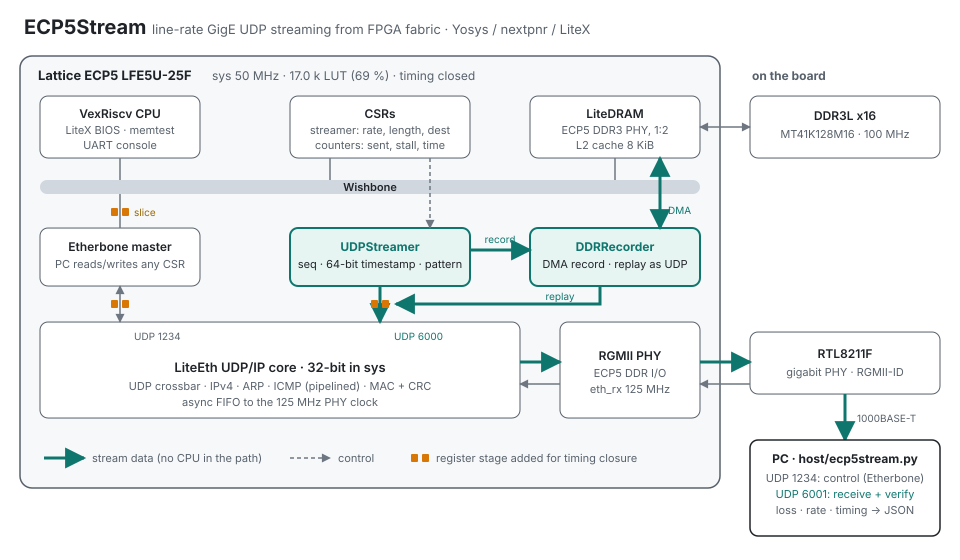

# ECP5Stream

Line-rate Gigabit Ethernet streaming from FPGA fabric on a Lattice ECP5, built entirely with the open-source flow (Yosys, nextpnr-ecp5, LiteX).

A hardware packet source in the fabric sends UDP at up to wire speed with no CPU in the data path. Every packet carries a sequence number, a 64-bit hardware timestamp and a checkable payload, so the PC verifies each one. The PC controls the FPGA's registers over the same link (Etherbone).

> **Status:** gateware built and timing-closed. Measurements on hardware are in progress; results land in `docs/` once they are taken.

## Hardware
A custom ECP5 board:
- LFE5U-25F-6BG256C, 50 MHz oscillator
- MT41K128M16 DDR3L (x16)
- Realtek RTL8211F gigabit PHY (RGMII)
- UART console

The board-specific parts are only `gateware/pcbc_bsp.py` and `gateware/pcbc_bsp_io.py`. Porting to another ECP5 board with DDR3 and an RGMII PHY means replacing those two files.

## Architecture


The stream path (teal) runs from `UDPStreamer` through LiteEth to the PHY with no CPU involvement. The PC sets the rate, length and destination over Etherbone, and reads the counters the same way. Orange marks show the register stages added to close timing at 50 MHz.

## What's in the repo
| Path | What |
|---|---|
| `gateware/streamer.py` | `UDPStreamer`: packet source; rate set by an inter-packet gap; counts backpressure cycles |
| `gateware/test_streamer.py` | cycle-level test (Migen simulator): exact packet spacing, data intact under random backpressure, stall count exact, counter reset |
| `gateware/ecp5stream_soc.py` | the SoC: CPU, DDR3, Ethernet, Etherbone, streamer |
| `gateware/pcbc_bsp*.py` | board support: I/O map, DDR3 clocking, PHY reset, safe levels for unused I/O |
| `gateware/build_tools.py` | nextpnr seed sweep: packs the passing seed with the most margin, never writes a failing bitstream |
| `gateware/load.py` | JTAG load to SRAM (openFPGALoader, FT2232H) |
| `host/ecp5stream.py` | PC tool: register access, receive + verify + measure, rate sweep to JSON |

## Packet format
32-bit little-endian words:

| Word | Content |
|---|---|
| 0 | `0x45435035` ("ECP5") |
| 1 | sequence number |
| 2–3 | timestamp, sys-clock cycles (64 bit) |
| i ≥ 4 | `seq XOR (i × 0x9E3779B9)` |

Every bit toggles, and the payload can be checked vectorised (numpy) at line rate.

## Timing closure
The first build closed at only 32.6 MHz against the 50 MHz target. The fixes, one critical path at a time:

| Build | Change | sys fmax |
|---|---|---|
| 1 | first build | 32.6 MHz: combinational `ready` chain from MAC TX through the IP/UDP crossbars and the users back into RX dispatch |
| 3 | register stage (valid + ready) on every user UDP port | 45.7 MHz: Etherbone address adder into the bus decoder |
| 4 | Wishbone register slice on the Etherbone master | 48.7 MHz: SPI-flash memory map behind the 2-master arbiter |
| 5 | SPI-flash core dropped (image runs from SRAM) | **51.3 MHz, PASS** |

Utilisation: 14.1 k LUT4 (58 %), 7.3 k FF, 37/56 EBR.

## Build and run
Needs the OSS CAD Suite, LiteX (with LiteEth, LiteDRAM) and a RISC-V GCC for the BIOS.
```
cd gateware
python test_streamer.py                  # cycle-level test
python ecp5stream_soc.py --seeds 8       # -> build/stream/gateware/ecp5stream.bit + build/stream/csr.csv
python load.py load                      # JTAG -> SRAM
cd ../host
python ecp5stream.py selftest            # checks the verifier itself
python ecp5stream.py info
python ecp5stream.py sweep --host-ip <PC address> --rates 100,300,500,700,900,950,1000 --seconds 5
```
Defaults: board 192.168.1.50, PC 192.168.1.100, stream to UDP 6001 (open it in the PC firewall).

## Licence
BSD-2-Clause, like LiteX.
